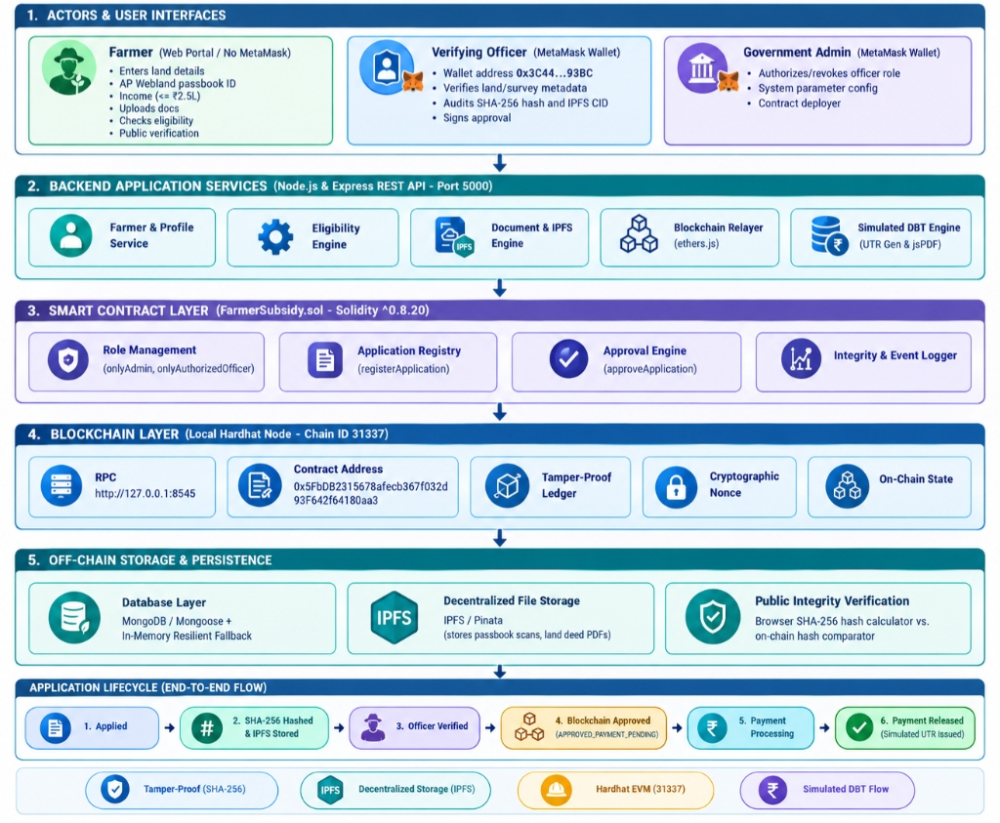

# KrishiSubsidy Portal — Blockchain-Based Farmer Subsidy Distribution System

[](https://soliditylang.org/)
[](https://hardhat.org/)
[](https://react.dev/)
[](https://nodejs.org/)
[](https://expressjs.com/)
[](https://www.mongodb.com/)
[](https://ipfs.tech/)
[](LICENSE)

> **An enterprise-grade, decentralized agricultural welfare governance platform** coupling an Ethereum-compatible Proof-of-Authority (PoA) blockchain network with a hybrid off-chain storage model to ensure tamper-evident document integrity, algorithmic duplicate claim prevention, transparent state auditing, and simulated Direct Benefit Transfer (DBT) verification.

---

## Architecture Overview

The KrishiSubsidy Portal is structured across a modular 5-tier architecture that completely segregates sensitive citizen Personally Identifiable Information (PII) from on-chain transactions while permanently anchoring cryptographic fingerprints to the distributed ledger:



### Five-Tier System Design
1. **Tier 1: Actors & User Interfaces**
   * **Farmer (Web Portal / No MetaMask):** Standard browser interface for rural smallholders to submit land records, Andhra Pradesh Webland passbooks, and track claims without paying gas or managing private keys.
   * **Verifying Officer (MetaMask Wallet):** Authenticated field revenue officers inspecting cadastral survey numbers, comparing SHA-256 document digests, and digitally signing state progressions.
   * **Government Admin (MetaMask Wallet):** Contract deployer administering scheme quotas, landholding ceilings, and field officer authorizations.
2. **Tier 2: Backend Application Services (Node.js & Express REST API - Port 5000)**
   * Farmer Profile Service, Eligibility Engine, Document & IPFS Engine, Blockchain Relayer (`ethers.js`), and Simulated DBT Settlement Engine.
3. **Tier 3: Smart Contract Layer (`FarmerSubsidy.sol` - Solidity `^0.8.20`)**
   * Role-Based Access Control (`onlyAdmin`, `onlyOfficer`), Application Registry, Approval State Machine, and permanent indexed EVM event logging.
4. **Tier 4: Blockchain & Consensus Layer (Local Hardhat EVM - Chain ID 31337)**
   * Deterministic Proof-of-Authority (PoA) block sealing at 2.0s intervals, ensuring zero cryptocurrency fee burden on citizens and near-zero carbon footprint.
5. **Tier 5: Off-Chain Storage & Persistence**
   * Dual-layer persistence: **MongoDB Atlas** for rich farmer profiles and application metadata; **IPFS/Pinata** for decentralized content-addressed file archival; client/server **SHA-256** hash comparison for instant public verification.

---

## Key Features

- **Walletless Farmer Experience:** Smallholder farmers do not require cryptocurrency tokens, browser extensions, or gas funds.
- **Cryptographic Document Non-Repudiation:** Scanned land deeds and passbooks are converted into SHA-256 hashes ($H_D = \text{SHA256}(D)$) before being anchored on-chain.
- **Dual-Tier Duplicate Claim Blocking:** Eliminates double-dipping across multiple districts by programmatically validating both the applicant wallet address and the document hash:
  $$\mathcal{P}_{\text{dup}}(\text{Addr}_F, \text{ID}_S, H_D) = \mathcal{M}_{\text{wallet}}(\text{Addr}_F, \text{ID}_S) \lor \mathcal{M}_{\text{doc}}(H_D)$$
- **Strict State Machine Lifecycle:** Applications transition through 5 deterministic stages:
  $$\text{PENDING} \longrightarrow \text{VERIFIED} \longrightarrow \text{APPROVED} \longrightarrow \text{PAYMENT\_PROCESSING} \longrightarrow \text{PAYMENT\_RELEASED}$$
- **Simulated DBT & Verifiable QR Receipts:** Every disbursed claim automatically mints a deterministic Unique Transaction Reference (`SIM-DBT-2026-XXXXXXX`) and generates an audit-ready PDF receipt containing a scannable QR verification code.

---

## Empirical Benchmarks & Performance

Empirically validated on an isolated EVM testbed running Proof-of-Authority consensus:

| Metric / Parameter | Empirical Measurement | System Impact & Significance |
| :--- | :---: | :--- |
| **Block Creation Latency ($N=30$)** | **4.286 ms** ($\sigma = 2.535\text{ ms}$) | High-throughput deterministic sealing |
| **95% Confidence Interval** | **[3.339 ms, 5.233 ms]** | Student's $t$-distribution ($df = 29, \alpha = 0.05$) |
| **PoA 2.0s Sealing Slot Utilization** | **0.214%** | Leaves **99.786%** network idle margin |
| **Authoritative On-Chain Footprint** | **256 Bytes** (8 EVM slots) | Fixed storage prevents state bloat |
| **Storage Space Reduction Ratio** | **99.95% to 99.99%** | Evaluated across 500 KB to 10 MB deed tiers |
| **Gas Saved via Off-Chain Model** | **Up to $6.55 \times 10^9$ gas** | Avoids direct on-chain binary storage costs |
| **Hash Verification Latency** | **0.14 ms** | Instant client-side document audit |

### Smart Contract Gas Profile
* `constructor()`: 4,210,524 gas (Initial contract deployment and scheme seeding)
* `addOfficer()`: 47,797 gas (Officer role enrollment)
* `createScheme()`: 235,485 gas (Agricultural scheme registration)
* `submitApplication()`: 325,640 gas (Initial on-chain claim submission)
* `verifyApplication()`: 52,332 gas (Officer identity & deed audit)
* `approveApplication()`: 35,321 gas (Administrative sanction)
* `releasePayment()`: 40,041 gas (Disbursement trigger)

---

## Repository Structure

```
Farmer-Subsidy-Blockchain/
├── contracts/                     # Hardhat & Solidity Smart Contracts
│   ├── contracts/
│   │   └── FarmerSubsidy.sol      # Core state machine & access control contract
│   ├── scripts/
│   │   ├── deploy.js              # Deployment & initial scheme seeding script
│   │   └── measure_real_metrics.js# Empirical gas & latency benchmarking suite
│   ├── test/
│   │   └── FarmerSubsidy.test.js  # Automated unit & integration tests
│   ├── hardhat.config.js          # Hardhat network & compiler configuration
│   └── package.json
│
├── backend/                       # Node.js + Express REST API Gateway
│   ├── config/                    # DB connection & Smart Contract ABIs
│   ├── controllers/               # Business logic (Farmer, Officer, Admin, Payment)
│   ├── middleware/                # Multer upload & centralized error handlers
│   ├── models/                    # MongoDB Mongoose schemas (Application, Scheme, etc.)
│   ├── routes/                    # Express REST endpoints
│   ├── services/                  # Blockchain relayer, IPFS pinning, SHA-256 hashing
│   ├── server.js                  # Application entry point (Port 5000)
│   └── .env.example               # Sanitized environment template
│
├── frontend/                      # React SPA (Vite + Tailwind CSS)
│   ├── public/                    # Static assets & icons
│   ├── src/
│   │   ├── components/            # Reusable UI widgets (Navbar, Footer, Modals)
│   │   ├── context/               # Web3 MetaMask wallet context
│   │   ├── pages/                 # Role-based dashboards (Farmer, Officer, Admin)
│   │   └── services/              # API and Ethers.js integration layer
│   ├── index.html
│   ├── vite.config.js
│   └── package.json
│
├── documentation/                 # Technical Specifications & Guides
│   ├── API_DOCUMENTATION.md       # Complete REST endpoint specifications
│   ├── ARCHITECTURE.md            # Deep-dive architectural design
│   ├── SETUP_GUIDE.md             # Execution instructions
│   └── PROJECT_SPECIFICATION.md   # Formal system specification
│
├── research_and_reports/          # Academic Publications & Reports
│   ├── Project_Report_KrishiSubsidy_Portal.docx # Official KARE Course Project Report
│   └── IEEE_Paper_KrishiSubsidy_Portal.docx    # Formatted Research Paper
│
├── architecture.jpg               # High-resolution 5-tier architecture blueprint
├── LICENSE                        # MIT Open Source License
└── README.md                      # Project documentation
```

---

## Getting Started

### Prerequisites
* **Node.js**: v18.0.0 or higher (v20.12.2 recommended)
* **npm**: v9.0.0 or higher
* **MetaMask**: Browser extension installed
* **MongoDB**: Local MongoDB instance or free MongoDB Atlas cluster

---

### Step 1: Clone the Repository
```bash
git clone https://github.com/<your-username>/Farmer-Subsidy-Blockchain.git
cd Farmer-Subsidy-Blockchain
```

---

### Step 2: Smart Contract Setup & Local Blockchain Node

1. Open a new terminal:
```bash
cd contracts
npm install
```

2. Start the local Hardhat EVM blockchain node:
```bash
npx hardhat node
```
*Keep this terminal running. It will expose a JSON-RPC endpoint at `http://127.0.0.1:8545` (Chain ID 31337) with 20 pre-funded test accounts.*

3. Open a second terminal to compile and deploy the smart contract:
```bash
cd contracts
npx hardhat run scripts/deploy.js --network localhost
```
*Note down the deployed contract address (typically `0x5FbDB2315678afecb367f032d93F642f64180aa3`).*

---

### Step 3: Backend API Setup

1. In a new terminal, navigate to the backend directory:
```bash
cd backend
npm install
```

2. Configure the environment variables:
```bash
cp .env.example .env
```
Edit `.env` with your database and API settings:
```ini
PORT=5000
NODE_ENV=development
MONGODB_URI=mongodb://localhost:27017/FarmerSubsidy
BLOCKCHAIN_RPC_URL=http://127.0.0.1:8545
CONTRACT_ADDRESS=0x5FbDB2315678afecb367f032d93F642f64180aa3
PINATA_API_KEY=your_pinata_key
PINATA_SECRET_API_KEY=your_pinata_secret
```

3. Start the backend server:
```bash
npm run dev
# Server will listen on http://localhost:5000
```

---

### Step 4: Frontend Web Application Setup

1. In a new terminal, navigate to the frontend directory:
```bash
cd frontend
npm install
```

2. Launch the Vite development server:
```bash
npm run dev
```

3. Open your browser and navigate to `http://localhost:5173`.

---

## Test Accounts & Roles

Import any of Hardhat's default private keys into MetaMask for role-based testing:

| Role | Wallet Address | Testbed Private Key (Hardhat Default) |
| :--- | :--- | :--- |
| **System Admin (Deployer)** | `0xf39Fd6e51aad88F6F4ce6aB8827279cffFb92266` | `0xac0974bec39a17e36ba4a6b4d238ff944bacb478cbed5efcae784d7bf4f2ff80` |
| **Verifying Field Officer** | `0x70997970C51812dc3A010C7d01b50e0d17dc79C8` | `0x59c6995e998f97a5a0044966f0945389dc9e86dae88c7a8412f4603b6b78690d` |
| **Applicant Farmer** | Any standard wallet or no wallet needed (Walletless onboarding) |

---

## Sustainable Development Goals (SDGs)

This project actively supports the United Nations 2030 Agenda:
* **SDG 1 (No Poverty):** Target 1.3 — Expand social protection systems for smallholder agrarian households.
* **SDG 2 (Zero Hunger):** Target 2.3 — Double agricultural productivity through timely input subsidy access.
* **SDG 8 (Decent Work & Economic Growth):** Target 8.10 — Strengthen capacity of domestic financial institutions.
* **SDG 16 (Peace, Justice & Strong Institutions):** Target 16.5 & 16.6 — Eliminate corruption and ensure transparent institutions.

---

## Project Team & Academic Attribution

Developed as a Course-Level Project for **`CSE223 / Applied Blockchain`** (Academic Year 2026–2027, Odd Semester) at **Kalasalingam Academy of Research and Education (Deemed to be University)**, Krishnankoil, Tamil Nadu, India.

### Project Team Members
* **G Rohith** — Reg. No: `99250040266`
* **G Nithin** — Reg. No: `99250040895`
* **M Chakradhar** — Reg. No: `99250040167`
* **G Pradeep** — Reg. No: `9925004025`

### Project Supervisor / Guide
* **Dr. P. Chinnasamy**  
  *Associate Professor, Department of Computer Science and Engineering*  
  *Kalasalingam Academy of Research and Education*

---

## License

This project is licensed under the MIT License — see the [LICENSE](LICENSE) file for details.
